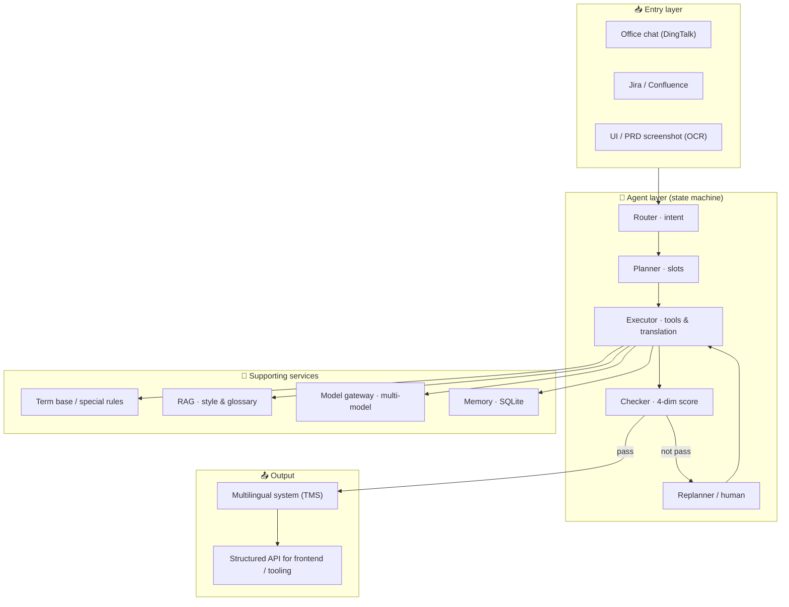

<div align="center">

# 🪿 GoGo-Translation-Agent

**An agentic translation agent that lives inside your office tools and writes back to the multilingual system.**

**入口在办公软件，输出直接回流多语言系统 —— 前端与技术同学都可直接调用。**

<br/>


[](#-agentic-reflection)

English | 简体中文

</div>

---

## 📑 Table of Contents

- [Why GoGo](#-why-gogo)
- [Key Features](#-key-features)
- [How It Works](#-how-it-works)
- [Architecture](#-architecture)
- [Agentic Reflection](#-agentic-reflection)
- [Terminology Governance](#-terminology-governance)
- [Tech Stack](#-tech-stack)
- [Quick Start](#-quick-start)
- [Call It As An API](#-call-it-as-an-api)
- [Evaluation](#-evaluation)
- [FAQ](#-faq)
- [Acknowledgments](#-acknowledgments)
- [License](#-license)

---

## 🤔 Why GoGo

Localization in a product team is usually a fragmented, human-heavy loop:

> A term shows up in a chat, a Jira ticket, a Confluence page, or a UI screenshot → someone manually copies it, normalizes the English, generates a key, checks for duplicates, files a task, waits for a translator, then pastes the result back.

The end-to-end cycle can take **about a week**; the model layer alone starts around **70% accuracy** and still needs heavy human review.

**GoGo-Translation-Agent collapses this into a single agentic loop.** You talk to it inside your office tool; it does the intake, translation, and terminology governance — and **writes the result straight back into the multilingual system (TMS)**. Frontend developers and tooling can call the same flow as an API.

> **Result (internal pilot):** end-to-end delivery **~1 week → ~1 day**; model-layer accuracy **70% → 96%** on the offline annotated set.
> *(口径：准确率为离线标注评测集上术语/语义正确率；具体数字以实测为准。)*

---

## ✨ Key Features

### 🤖 Agentic Intake, Inside Office Tools

- **Entry via office software** (e.g. DingTalk) and other sources — Jira, Confluence, PRD/UI screenshots (OCR).
- **Identity gate** — enterprise email + verification code before any action.
- Recognizes the four common requests right inside the chat:
  1. **新增词条提单** — send a term or a Confluence/Jira link
  2. **补语种** — add translations for an existing key
  3. **单语种修订** — fix one language's translation
  4. **修改默认提单选项** — adjust translation style, deadline, etc.
- Intent recognition → slot filling → English normalization → key generation → duplicate check → task creation.

### 🔁 Agentic Reflection with Self-Optimization

- **Translate → Reflect → Improve** cycle (inspired by Andrew Ng's reflection workflow).
- **Four-dimensional quality evaluation:** accuracy · fluency · style consistency · terminology consistency.
- Dual-model cross-validation; the best result is kept; a quality gate routes to **auto-pass / sample review / forced human review**.
- *Trade-off:* multiple model calls per batch in exchange for significantly higher quality — optimized with caching and small-model routing.

### 📚 Terminology Governance & Data Flywheel

- Standard term base + exception tickets + special-case rules + review highlights.
- **Conflict priority:** official > human-confirmed > latest > most-recent-in-context.
- Human post-edits are automatically written back into term rules and few-shot examples — a **produce → correct → feed back** flywheel.

### 🔒 Format Protection

Automatically protects:

- **Placeholders / variables:** `{variable}`, `{{count}}`, `%s`, `%(name)d`
- **HTML tags:** `<b>`, `<span class="x">`, `<a href="...">`
- **URLs** and **Markdown:** `**bold**`, `*italic*`, `[link](url)`

### 🔌 Writes Back & Callable by Engineers

- Output is written **directly back into TMS / the multilingual system** — no manual copy-paste.
- Frontend developers and tooling can call the **same flow via API** and receive structured results.

---

## ⚙️ How It Works

A state-machine-driven agent — **deterministic skeleton + probabilistic intelligence**:

```
identity verify
      ↓
  ROUTER  (intent + confidence)
      ↓
  PLANNER (slots + steps, ask if missing)
      ↓
  EXECUTOR (normalize → key → dedup → retrieve terms → translate)
      ↓
  CHECKER (4-dim score + cross validation)
      ↓
 auto-pass? ── no ──→ REPLANNER / human review
      ↓ yes
 write back to TMS → update memory & term base
```

The state machine defines legal transitions; the **model cannot skip stages**. Low confidence at any stage triggers clarification or a fallback instead of a guess.

---

## 🏗️ Architecture



### Layer responsibilities

| Layer | Responsibility |
|---|---|
| **Entry** | Collect fragmented text from chat / tickets / pages / OCR; identity verification |
| **Intake Agent** | Intent, slot filling, normalization, key generation & dedup |
| **Translation** | Cross validation, reflection-improvement, 4-dim scoring, human fallback |
| **Terminology** | Term base, exceptions, special rules, conflict priority, write-back |
| **Gateway** | Multi-model routing, rate limiting, retry, fallback, trace logging |
| **Output** | Write back to TMS; expose a structured API |

---

## 🔄 Agentic Reflection

The model acts as both translator and reviewer:

**Step 1 — Translate (1× call)**
```
Source: "Welcome to {app_name}"
Initial: "欢迎使用 {app_name}"
```

**Step 2 — Reflect (1× call)**
```
Review across 4 dimensions — accuracy / fluency / style / terminology.
"准确，但'欢迎来到'比'欢迎使用'更贴合 welcoming 的语气。"
```

**Step 3 — Improve (1× call)**
```
Improved: "欢迎来到 {app_name}"
```

Why it works: the same model that translated understands the context, so it can catch subtle fluency and tone issues that a single-pass translation misses.

---

## 📚 Terminology Governance

**Conflict priority:** official > human-confirmed > latest > most-recent-in-context.

Human post-edits become term rules and few-shot examples automatically; exception tickets route to admins for a decision, then flow back to the term base.

---

## 🧰 Tech Stack

| Area | Stack |
|---|---|
| **Agent** | Python, state machine (Router–Planner–Executor–Checker–Replanner), Function Calling |
| **POC** | Low-code / no-code platform for fast validation |
| **RAG** | Document parsing, embedding, hybrid retrieval (vector + BM25), rerank |
| **Models** | Multi-model via gateway; small models for classification, stronger models for planning/generation |
| **Storage** | SQLite (tasks, terms, memory) |
| **Gateway** | Auth, rate limiting, retry, fallback/failover, full-trace logging |
| **Quality** | Offline eval set, regression, human-in-the-loop |

---

## 🚀 Quick Start

```bash
# 1. Clone
git clone https://github.com/DAgogo04/GoGo-Translation-Agent.git
cd GoGo-Translation-Agent

# 2. Configure your model gateway key
export MODEL_API_KEY=sk-...

# 3. Run an intake + translation task
python -m gogo_agent --intent add_term --source "Welcome to {app_name}" --to zh
```

Talking to it in your office tool:
> **你：** 我要新增一个词条 "Welcome to {app_name}"
> **Agent：** 识别意图 → 归一化 → 生成 key 并查重 → 翻译并评分 → 写回 TMS → 回执

---

## 🔌 Call It As An API

Frontend developers and tooling can call the same flow:

```http
POST /api/translate
Content-Type: application/json

{
  "intent": "add_term",
  "source_text": "Welcome to {app_name}",
  "target_languages": ["zh", "ja", "ko"],
  "style": "product_ui"
}
```

Response:

```json
{
  "key": "welcome.to_app_name",
  "translations": {
    "zh": "欢迎来到 {app_name}",
    "ja": "{app_name}へようこそ",
    "ko": "{app_name}에 오신 것을 환영합니다"
  },
  "quality_score": 0.96,
  "written_back": true
}
```

---

## 📊 Evaluation

- **Offline:** gold-standard set across language × content type × difficulty; **COMET** as the primary metric, with BLEU / chrF / TER; MQM/DQF for human classification.
- **Online:** canary release, A/B, behavioral instrumentation, human spot-check.
- **Guardrails:** auto-pass rate, human takeover rate, single-task cost, hallucination rate.
- If offline gains but online doesn't, the eval set is out of distribution — rebuild it from real traffic.

---

## ❓ FAQ

**Why not just let the model decide the next step?**
A pure autonomous loop is probabilistic — it skips steps, loops, and can't be reproduced or audited. A production localization flow needs determinism, so the state machine owns transitions and the model handles semantics.

**Why not end-to-end generation?**
Localization must preserve keys, variables, and formatting. Parameter/tool control keeps changes interpretable and protects structure; end-to-end generation risks corrupting it.

**How do you prevent fake efficiency?**
We report cycle time **together with** first-pass rate and rework rate. Faster output with more rework is not efficiency.

---

## 🙏 Acknowledgments

- The reflection workflow draws on Andrew Ng's **translation-agent** and the agentic translation ideas behind it.
- The production-grade, format-protection framing takes inspiration from projects like **jta** (JSON Translation Agent).

---

## 📄 License

[MIT](LICENSE)

<div align="center">
<b>GoGo-Translation-Agent</b> · office-tool-in, multilingual-system-out · an illustrative agentic project
</div>
